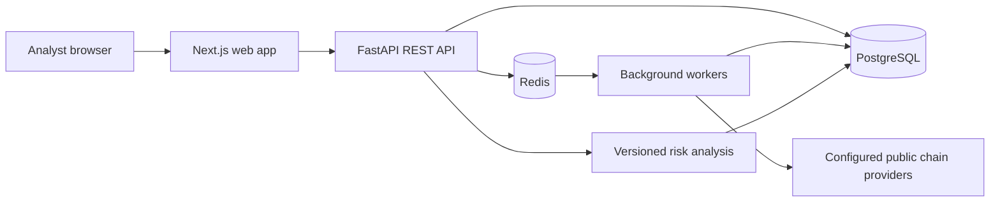

# ChainGuard AI

ChainGuard AI is planned as a blockchain transaction monitoring, risk triage, and digital-forensics investigation platform. It is intended to analyze public blockchain information; it will not custody funds or request wallet seed phrases.

> **Implementation status:** The repository includes an initial FastAPI/PostgreSQL backend for identity, Bitcoin transaction and live address-history lookups, uncalibrated rule-based risk triage, alerts, investigation cases, and SHA-256-verified evidence uploads. MFA, Ethereum, graph workflows, trained/calibrated models, rate limiting, and production hardening are not complete. This is not production-ready and must not be used for operational investigations or decisions.

## Planned capabilities

- Bitcoin and Ethereum data ingestion from configured public data providers.
- Explainable risk indicators with calibrated scores, model/version provenance, and a clear distinction between suspicious activity and confirmed fraud.
- Analyst-managed alerts, investigations, evidence provenance, chain of custody, and reports.
- Organization-scoped access controls, audit trails, and operational monitoring.

The current Bitcoin adapter uses a configured HTTPS API compatible with mempool.space to retrieve individual transactions and paginated address history. Individual transaction payloads are persisted as distinct observations; address-history pages are validated and returned live with provider provenance, but are not persisted. Block ingestion, reorganization orchestration, streaming ingestion, Ethereum, ML training, model calibration, and external threat-intelligence integrations remain future work. The initial rules score is explicitly uncalibrated and must not be interpreted as a fraud probability.

The planned system boundaries, trust assumptions, and project layout are described in [docs/architecture.md](docs/architecture.md). These are design targets, not claims about implemented controls.

## Architecture

The target system is a modular monorepo. A versioned FastAPI service owns the initial identity endpoints and will grow to own tenant-scoped persistence, blockchain normalization, risk analysis, case workflows, and audit events. A Next.js application will consume that API. PostgreSQL is the source of truth; Redis is reserved for future background work and short-lived coordination. Optional graph storage and external providers will be isolated behind adapters.



## Local development infrastructure

### Prerequisites

- Windows 10/11 with Docker Desktop configured for Linux containers (WSL 2 backend recommended), or a compatible Docker Engine with Docker Compose v2.
- Git.

Docker Compose provisions PostgreSQL, Redis, and the API. The API image installs the pinned Python dependencies and applies Alembic migrations before starting. The frontend is a separate Next.js application and can run locally against the API. Backend tests and frontend typecheck/build have been run using temporary local Python and Node toolchains; Docker Compose runtime validation has not been run.

### Start services on Windows

From PowerShell in the repository root:

```powershell
Copy-Item .env.example .env
notepad .env
docker compose up -d
docker compose ps
```

Replace the example password in both `POSTGRES_PASSWORD` and `DATABASE_URL` with the same URL-safe, local-only secret before starting. The sample is a placeholder, not a credential. Ports bind to `127.0.0.1` so services are not exposed to the local network by default. The initial API health endpoint is `http://127.0.0.1:8000/api/v1/system/health`.

Create the first organization administrator after the API is healthy:

```powershell
docker compose exec api python -m app.bootstrap
```

The bootstrap command is permitted only while the database has no organization or user. It prompts for the organization, administrator email, and a 14-character minimum password; the password is hashed and is never placed in an environment variable.

Login uses `POST /api/v1/auth/login` with JSON `{"email":"...","password":"..."}`. Pass the returned bearer token to `GET /api/v1/auth/me`; `POST /api/v1/auth/logout` revokes only that session. Tokens are opaque random values; only their SHA-256 digests are stored.

The authenticated API currently also exposes:

| Method and path | Purpose |
| --- | --- |
| `GET /api/v1/system/health` | Database-backed service health |
| `POST /api/v1/auth/accept-invitation` | Accept a one-time organization invitation |
| `/api/v1/admin/users` and `/api/v1/admin/invitations` | Administrator-scoped user management and invitation issuance |
| `GET /api/v1/transactions` | Paginated stored public transaction observations |
| `GET /api/v1/transactions/bitcoin/{txid}` | Fetch and persist a transaction from the configured provider |
| `GET /api/v1/addresses/bitcoin/{address}` | Fetch live address totals and a 25-transaction history page; pass `cursor` for older pages |
| `POST /api/v1/risk/analyze` | Analyze an ingested transaction using explicitly uncalibrated rules |
| `GET /api/v1/alerts` / `PATCH /api/v1/alerts/{id}` | Organization-scoped alert triage |
| `/api/v1/cases` | Organization-scoped case CRUD, notes, transaction links, events, and JSON report |
| `/api/v1/cases/{id}/evidence` | Upload/list case evidence; uploads are limited to 10 MiB |
| `/api/v1/cases/{id}/evidence/{evidence_id}/download` | Verify SHA-256 before attachment download and record custody event |

These endpoints are a starting point, not a complete API contract. Organization scoping is enforced in case/alert/risk queries; blockchain observations contain public chain data and are shared across tenants. The API does not yet include rate limiting, MFA, password reset, or a full role-specific permission policy. User administration and invite creation require the administrator role; invitations expire after 24 hours and are accepted once.

To stop the services while retaining database state:

```powershell
docker compose down
```

To remove the local database contents as well, use `docker compose down --volumes`. This permanently deletes the Compose-managed local database volume.

### Backend tests

The tests use an in-memory SQLite database and do not require Docker services. With Python 3.12 installed:

```powershell
cd backend
py -3.12 -m venv .venv
.\.venv\Scripts\Activate.ps1
python -m pip install -r requirements-test.txt
python -m pytest
```

Direct dependency versions are pinned in the requirements files; a generated transitive lockfile is still outstanding. The latest backend test run passed all 19 tests. Frontend typecheck and production build are also validated; the test suite uses an in-memory SQLite database and does not require Docker.

### Frontend

With Node.js 22 installed, create the npm lockfile on first setup, then run the dashboard:

```powershell
cd frontend
Copy-Item .env.example .env.local
npm install
npm run dev
```

Set `BACKEND_API_URL=http://127.0.0.1:8000` in `frontend/.env.local` when launching Next.js from the host. Sign-in is proxied through Next.js, and the opaque API token is held in an HttpOnly, SameSite=Strict cookie rather than browser storage. The UI currently covers login, transaction lookup/risk, alert triage, case creation/details, notes, evidence upload/download, and JSON report export.

### Configuration

`.env.example` documents the variables used by `docker-compose.yml`. Copy it to `.env`; `.env` is ignored by Git. Never put production credentials, provider API keys, wallet secrets, or real case data in the example file.

## Repository layout

| Path | Purpose |
| --- | --- |
| `backend/` | FastAPI application, initial identity models/API, migrations, and tests |
| `frontend/` | Next.js analyst dashboard and case details |
| `blockchain/` | Provider adapters and normalized chain data (planned) |
| `ml/` | Reproducible feature, training, inference, and evaluation code (planned) |
| `tests/` | Unit, integration, and end-to-end tests (planned) |
| `docs/` | Architecture, operations, data provenance, and limitations |
| `infrastructure/` | Deployment and monitoring configuration (planned) |

Directories are introduced with their implementation rather than empty placeholder files.

## Development phases

Work is staged to keep each layer reviewable and verifiable:

1. Repository setup, architecture, and development environment — **complete (not runtime-validated)**.
2. FastAPI, PostgreSQL schema/migrations, and authentication — **login/session/bootstrap/admin invitation and user management implemented; MFA, password reset, and full RBAC remain**.
3. Bitcoin ingestion and normalization — **individual transaction provider lookup, deduplication, observation history, and live paginated address-history lookup implemented; address pages are not persisted, while block ingestion and reorganization orchestration remain**.
4. Risk analysis — **uncalibrated explainable rules baseline implemented; ML training, evaluation, and calibration remain**.
5. Alerts, cases, notes, transaction links, evidence hashing/custody, and JSON case reports — **initial APIs implemented; broader workflow/report formats and supervisory review remain**.
6. Next.js dashboard and transaction explorer — **initial API-connected dashboard and case details implemented; graph view and remaining analyst modules remain**.
7. Graph exploration — **not implemented**.
8. Ethereum and reviewed threat-intelligence integrations — **not implemented**.
9. Automated testing, security hardening, observability, and performance work — **focused tests and CI added; runtime checks and broader coverage remain**.
10. Deployment preparation and operational documentation — **local Compose setup only; production deployment and backup/restore remain**.

No phase is considered complete until its implementation and relevant checks are present and executed. See [CONTRIBUTING.md](CONTRIBUTING.md) for development expectations.

## Responsible-use and limitations

- Only public blockchain data and properly licensed or permitted intelligence sources are in scope.
- An anomaly or elevated risk score is a triage signal, not proof of fraud or attribution to a person.
- Scores must not be described as fraud probabilities without empirical validation and calibration.
- Demonstration data, when added, must be explicitly labeled synthetic and kept separate from live provider data.
- This repository has not been security-reviewed or validated for production use.

See [SECURITY.md](SECURITY.md) for vulnerability reporting and security boundaries.
