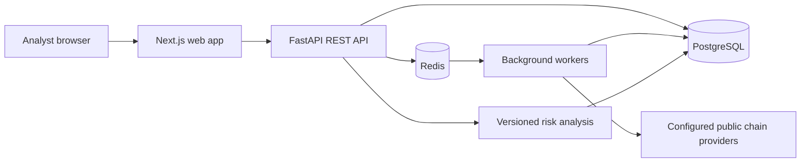

# ChainGuard AI

ChainGuard AI is planned as a blockchain transaction monitoring, risk triage, and digital-forensics investigation platform. It is intended to analyze public blockchain information; it will not custody funds or request wallet seed phrases.

> **Implementation status:** Phase 1 is complete. Phase 2 has an initial FastAPI service, PostgreSQL identity/audit schema, password-based login, revocable sessions, and a bootstrap administrator flow. The frontend, MFA, invitations, blockchain ingestion, risk models, and investigation workflows are not implemented. This is not production-ready and must not be used for operational investigations or decisions.

## Planned capabilities

- Bitcoin and Ethereum data ingestion from configured public data providers.
- Explainable risk indicators with calibrated scores, model/version provenance, and a clear distinction between suspicious activity and confirmed fraud.
- Analyst-managed alerts, investigations, evidence provenance, chain of custody, and reports.
- Organization-scoped access controls, audit trails, and operational monitoring.

The planned system boundaries, trust assumptions, and project layout are described in [docs/architecture.md](docs/architecture.md). These are design targets, not claims about implemented controls.

## Architecture

The target system is a modular monorepo. A versioned FastAPI service owns the initial identity endpoints and will grow to own tenant-scoped persistence, blockchain normalization, risk analysis, case workflows, and audit events. A Next.js application will consume that API. PostgreSQL is the source of truth; Redis is reserved for future background work and short-lived coordination. Optional graph storage and external providers will be isolated behind adapters.



## Local development infrastructure

### Prerequisites

- Windows 10/11 with Docker Desktop configured for Linux containers (WSL 2 backend recommended), or a compatible Docker Engine with Docker Compose v2.
- Git.

Docker Compose provisions PostgreSQL, Redis, and the initial API. The API image installs the pinned Python dependencies and applies Alembic migrations before starting. The repository has not yet been validated in an environment with Docker, Python, or Node.js installed.

### Start services on Windows

From PowerShell in the repository root:

```powershell
Copy-Item .env.example .env
notepad .env
docker compose up -d
docker compose ps
```

Replace the example password in both `POSTGRES_PASSWORD` and `DATABASE_URL` with the same URL-safe, local-only secret before starting. The sample is a placeholder, not a credential. Ports bind to `127.0.0.1` so services are not exposed to the local network by default. The initial API health endpoint is `http://127.0.0.1:8000/api/v1/system/health`.

Create the first organization administrator after the API is healthy:

```powershell
docker compose exec api python -m app.bootstrap
```

The bootstrap command is permitted only while the database has no organization or user. It prompts for the organization, administrator email, and a 14-character minimum password; the password is hashed and is never placed in an environment variable.

Login uses `POST /api/v1/auth/login` with JSON `{"email":"...","password":"..."}`. Pass the returned bearer token to `GET /api/v1/auth/me`; `POST /api/v1/auth/logout` revokes only that session. Tokens are opaque random values; only their SHA-256 digests are stored.

To stop the services while retaining database state:

```powershell
docker compose down
```

To remove the local database contents as well, use `docker compose down --volumes`. This permanently deletes the Compose-managed local database volume.

### Backend tests

The tests use an in-memory SQLite database and do not require Docker services. With Python 3.12 installed:

```powershell
cd backend
py -3.12 -m venv .venv
.\.venv\Scripts\Activate.ps1
python -m pip install -r requirements-test.txt
python -m pytest
```

Dependency versions are pinned directly in the requirements files; a generated transitive lockfile is still outstanding. These tests have not yet been executed in this environment.

### Configuration

`.env.example` documents the variables used by `docker-compose.yml`. Copy it to `.env`; `.env` is ignored by Git. Never put production credentials, provider API keys, wallet secrets, or real case data in the example file.

## Repository layout

| Path | Purpose |
| --- | --- |
| `backend/` | FastAPI application, initial identity models/API, migrations, and tests |
| `frontend/` | Next.js analyst interface (planned) |
| `blockchain/` | Provider adapters and normalized chain data (planned) |
| `ml/` | Reproducible feature, training, inference, and evaluation code (planned) |
| `tests/` | Unit, integration, and end-to-end tests (planned) |
| `docs/` | Architecture, operations, data provenance, and limitations |
| `infrastructure/` | Deployment and monitoring configuration (planned) |

Directories are introduced with their implementation rather than empty placeholder files.

## Development phases

Work is staged to keep each layer reviewable and verifiable:

1. Repository setup, architecture, and development environment — **complete (not runtime-validated)**.
2. FastAPI, PostgreSQL schema/migrations, and authentication — **initial foundation implemented; MFA, invitations, and resource-level authorization coverage remain**.
3. Bitcoin ingestion, normalization, transaction lookup, and address search.
4. Risk analysis pipeline, baselines, evaluation, and score explanations.
5. Alerts and investigation case workflows.
6. Next.js dashboard and transaction explorer.
7. Graph exploration and evidence management.
8. Ethereum and reviewed threat-intelligence integrations.
9. Automated testing, security hardening, observability, and performance work.
10. Deployment preparation and operational documentation.

No phase is considered complete until its implementation and relevant checks are present and executed. See [CONTRIBUTING.md](CONTRIBUTING.md) for development expectations.

## Responsible-use and limitations

- Only public blockchain data and properly licensed or permitted intelligence sources are in scope.
- An anomaly or elevated risk score is a triage signal, not proof of fraud or attribution to a person.
- Scores must not be described as fraud probabilities without empirical validation and calibration.
- Demonstration data, when added, must be explicitly labeled synthetic and kept separate from live provider data.
- This repository has not been security-reviewed or validated for production use.

See [SECURITY.md](SECURITY.md) for vulnerability reporting and security boundaries.
